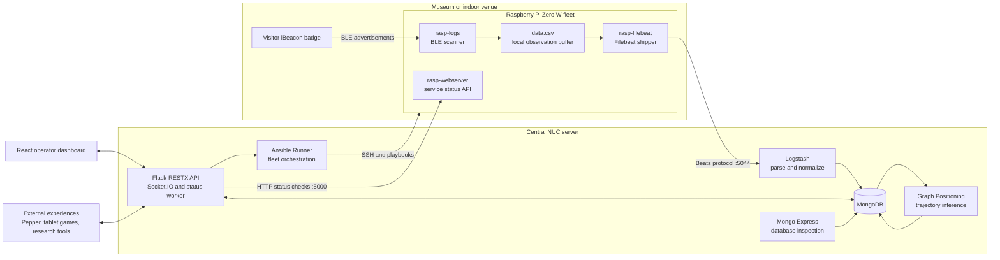
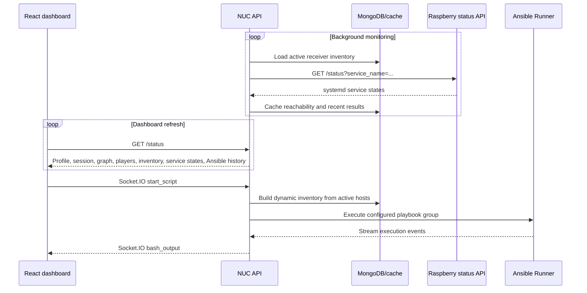

# Indoor Visitor Micro-Location Platform

> A full-stack IoT prototype for detecting BLE-equipped visitors, reconstructing their movement through an indoor venue, and operating a fleet of Raspberry Pi receivers from one dashboard.

This workspace brings together the projects developed for a third-year Computer Science internship at the **L3i laboratory of La Rochelle University**, from 18 March to 26 June 2024. The pilot installation was tested as a technical foundation for cultural and educational experiences such as serious games.

The repository is best understood as one distributed system rather than five unrelated applications:

1. Visitors carry uniquely identifiable **iBeacon BLE badges**.
2. A fleet of **Raspberry Pi Zero W** devices detects nearby badge advertisements.
3. Each Raspberry records observations locally and **Filebeat** forwards them to the central server.
4. **Logstash** parses the observations and stores them in **MongoDB**.
5. A **Graph Positioning** service converts signal observations into likely visitor movements through a known indoor graph.
6. A **Flask REST API and Socket.IO server** exposes the system state and controls the Raspberry fleet through **Ansible**.
7. A **React dashboard** lets an operator manage profiles, sessions, receivers, maps, players, and deployments.

The result is a configurable, near-real-time micro-location environment that can be reused across different venues and connected to external experiences such as a tablet game or the Pepper robot.

## Contents

- [What was built](#what-was-built)
- [System architecture](#system-architecture)
- [End-to-end data flow](#end-to-end-data-flow)
- [Control and monitoring flow](#control-and-monitoring-flow)
- [Projects in this workspace](#projects-in-this-workspace)
- [Dashboard capabilities](#dashboard-capabilities)
- [Positioning model](#positioning-model)
- [Domain model](#domain-model)
- [API overview](#api-overview)
- [Technology stack](#technology-stack)
- [Repository map](#repository-map)
- [Running the platform](#running-the-platform)
- [Documentation and demonstrations](#documentation-and-demonstrations)
- [Project context and status](#project-context-and-status)

## What was built

The platform covers the complete path from a physical BLE signal to an operator-facing movement trace.

| Capability | Delivered result |
| --- | --- |
| BLE collection | Cross-platform Python scanner with a Linux implementation for Raspberry Pi and a macOS implementation for development |
| Edge logging | Buffered CSV observations containing receiver identity, timestamp, badge identifiers, transmission power, and RSSI |
| Lightweight forwarding | ARMv6l-compatible Filebeat package and system service for Raspberry Pi Zero W |
| Central ingestion | Logstash pipeline using Grok to structure incoming CSV events and write them to MongoDB |
| Indoor positioning | Graph-based trajectory reconstruction using signal strength, observation count, travel distance, and movement history |
| Data model | MongoDB collections for profiles, graphs, receiver groups, hosts, sessions, players, raw logs, cache, and Ansible execution logs |
| Management API | Flask-RESTX API with Swagger documentation for profiles, sessions, players, inventory, graphs, and status |
| Fleet monitoring | Lightweight Flask service on every Raspberry plus a central background status collector |
| Fleet orchestration | Dynamic Ansible inventory, configurable playbook groups, and streamed execution output through Socket.IO |
| Operator dashboard | React interface for inventory, maps, profiles, sessions, players, monitoring, and orchestration |
| Deployment | Docker Compose stack for the central MongoDB, Mongo Express, Logstash, API, and positioning services |

## System architecture

The system has three main zones: visitor badges, Raspberry Pi edge receivers, and the central NUC server. The browser dashboard and external experiences use the NUC API as their integration point.



Two paths coexist:

- The **data path** transports BLE observations toward MongoDB and turns them into player positions.
- The **control path** monitors and configures the receiver fleet, runs playbooks, and presents state to operators.

Keeping these paths separate lets the Raspberry Pi devices remain lightweight while the NUC performs storage, orchestration, and positioning work.

## End-to-end data flow

### 1. Badge detection

Each visitor badge periodically broadcasts an iBeacon advertisement. The relevant values are:

| Field | Meaning in this project |
| --- | --- |
| UUID | Identifies the beacon family |
| Major | Shared filter used to select the experiment's badges |
| Minor | Uniquely identifies a visitor badge |
| TX power | Reference signal strength at one metre |
| RSSI | Signal strength observed by a particular Raspberry Pi |

The `rasp-logs-main` service scans for these advertisements, filters them by the configured major value, and records the observations.

### 2. Local observation format

Each detected advertisement is written as one CSV row:

```text
identity,timestamp,major,minor,tx_power,rssi
```

`identity` is the hostname of the Raspberry receiver. Combining it with the receiver-to-node mapping tells the central system where the observation was made.

### 3. Forwarding and ingestion

`rasp-filebeat-main` watches `/home/admin/data/*.csv` and sends new entries to Logstash on the NUC. Logstash applies the following logical steps:

1. Accept events through the Beats input.
2. Parse the CSV message with a Grok pattern.
3. Type the numeric badge and signal fields.
4. Store the structured event in the configured MongoDB logs collection.

Only Filebeat and Logstash are used from the broader Elastic stack. Elasticsearch and Kibana were intentionally omitted because MongoDB and the custom dashboard cover the storage and presentation needs with less overhead on this installation.

### 4. Position reconstruction

The Graph Positioning worker periodically reads:

- new BLE observations for players in the active session;
- the active profile's graph of possible movements;
- the active receiver group and its receiver-to-node assignments;
- each player's previous position and visited-node history.

It scores candidate receiver nodes, reconstructs a plausible path through the graph, and updates the player document with fields such as `last_visited`, `has_visited`, and `temporal_sequence_visited`.

### 5. Consumption

The API exposes the processed state to:

- the React dashboard for live monitoring and replay;
- serious games that register players or check whether a location was visited;
- robots or other interactive devices that adapt an experience to a visitor's path;
- researchers performing post-session movement analysis.

## Control and monitoring flow

The platform avoids using slow SSH operations for frequent health checks. Every Raspberry instead runs the small `rasp-webserver-main` service, which reports the state of requested systemd services through HTTP.



The dynamic inventory is generated from the database. Operators can choose which receivers are active, then start, stop, install, or update services across the selected fleet without editing an Ansible inventory file by hand.

Configured orchestration groups include:

- first-time Raspberry setup;
- start all collection services;
- stop collection services;
- update the BLE logging project;
- update Filebeat;
- update the Raspberry status web service;
- check or correct time synchronization.

## Projects in this workspace

### 1. `nuc-config-main` - central platform

**Role:** Hosts the server-side infrastructure and all central business logic.

**Main responsibilities:**

- run MongoDB and Mongo Express;
- ingest observations through Logstash;
- expose the REST and Socket.IO API;
- store configuration, experiment, and player state;
- compute player trajectories;
- execute Ansible playbooks against a dynamic fleet inventory;
- provide DNS, DHCP, forwarding, and installation notes for the local deployment.

**Important areas:**

| Path | Purpose |
| --- | --- |
| [`docker-compose.yml`](./nuc-config-main/docker-compose.yml) | Central service topology |
| [`config.yaml`](./nuc-config-main/config.yaml) | Positioning parameters and named Ansible workflows |
| [`modules/api`](./nuc-config-main/modules/api) | Flask-RESTX API, Socket.IO events, monitoring worker, and Ansible integration |
| [`modules/database`](./nuc-config-main/modules/database) | MongoDB collections, validation, fixtures, queries, and domain utilities |
| [`modules/graph-positioning`](./nuc-config-main/modules/graph-positioning) | Signal processing and graph-based trajectory reconstruction |
| [`logstash`](./nuc-config-main/logstash) | Beats input, Grok parsing, and MongoDB output |
| [`ansible/playbooks`](./nuc-config-main/ansible/playbooks) | Fleet setup, service control, time control, and project updates |
| [`setup`](./nuc-config-main/setup) | DNS, DHCP, and network-forwarding support |

Central Docker services:


### 2. `nuc-web-main` - operator dashboard

**Role:** Gives a non-technical operator one place to configure, observe, and control the installation.

**Implementation:** React 18, Material UI, React Router, Axios, Socket.IO Client, Mermaid, i18next, and SVG pan/zoom tooling.

**Pages:**

- **Inventory** - add, edit, remove, activate, pair, and inspect Raspberry receivers.
- **Ansible** - select receivers, launch a configured workflow, and follow streamed execution output.
- **Graph** - position nodes over an SVG floor plan, connect possible paths, pair receivers with nodes, and export YAML.
- **Players** - inspect current or historical sessions and replay inferred player movements on the map.

The top bar manages experiment profiles and session lifecycle. The status provider refreshes the combined platform state regularly, while focused providers encapsulate inventory, graph, player, and orchestration actions.

### 3. `rasp-logs-main` - BLE edge collector

**Role:** Detects iBeacon advertisements and writes normalized observations on each Raspberry Pi.

**Implementation details:**

- Python service installed through `rasplogs.service`;
- Bluepy-backed Linux scanner for the target Raspberry hardware;
- CoreBluetooth/macOS implementation for development tests;
- configurable major filter and buffer sizes;
- clean signal handling and buffered log writing;
- separate diagnostic log and BLE data CSV outputs.

This project is deliberately independent from Filebeat so application updates do not require repeatedly transferring the much larger ARM Filebeat distribution.

### 4. `rasp-filebeat-main` - edge data shipper

**Role:** Moves locally collected CSV observations from every Raspberry to the NUC.

The project packages Filebeat 7.15.2 for the Raspberry Pi Zero W's ARMv6l architecture, its configuration, a systemd unit, and an installation script. Filebeat watches the collector's data directory and forwards changes to the Logstash Beats endpoint.

### 5. `rasp-webserver-main` - edge health agent

**Role:** Provides fast, lightweight health information without opening an SSH session for every check.

The Flask service exposes:

```text
GET /status?service_name=filebeat&service_name=rasplogs
```

It queries systemd and returns each requested service's state. The NUC monitoring worker combines that result with network reachability and recent ping history for display in the dashboard.

## Dashboard capabilities

### Profiles and sessions

A **profile** represents a reusable venue or experiment configuration. It links one receiver group, one movement graph, an SVG floor plan, and its session history. Switching profiles makes the same physical platform reusable in different spaces or scenarios.

A **session** represents a bounded collection period. Starting a session lets external experiences register players and enables the positioning worker to update them. Finishing it preserves the movement history for later replay and analysis.

### Inventory and health

For every Raspberry, the dashboard can show:

- DNS hostname;
- whether it participates in orchestration;
- graph node assignment;
- current network reachability;
- current `rasplogs` and `filebeat` service states;
- recent ping history and last successful contact.

### Graph editor

The graph editor overlays positioned nodes on an SVG map of the venue. Operators can define edges only where physical movement is possible and associate each receiver with a graph node. This topology constrains the positioning algorithm and prevents physically impossible jumps between distant rooms.

### Player replay

Player state retains both a set of visited nodes and a time-indexed sequence of inferred movements. The dashboard can draw that movement over the profile map, filter a session interval, and replay the route for operational validation or post-experiment analysis.

### Orchestration terminal

The orchestration page combines receiver selection, named playbook groups, historic execution records, and live terminal-style output. Socket.IO is used because execution feedback is bidirectional and incremental rather than a single request/response operation.

## Positioning model

Indoor BLE values fluctuate with walls, furniture, people, device orientation, and radio interference. The platform therefore does not treat the strongest individual observation as a guaranteed physical position.

Instead, observations are grouped and candidate nodes are scored using configurable factors:

- average RSSI strength;
- number of observations received by a node;
- distance from the player's previous position;
- minimum and maximum RSSI bounds;
- minimum and maximum path-distance bounds;
- a confidence threshold;
- the graph of physically possible transitions.

The algorithm then uses the graph and the player's history to generate a plausible route. Its output is designed for **near-real-time experience logic and post-analysis**, not safety-critical or centimetre-accurate positioning.

The included visual test tooling demonstrates how a raw observation stream becomes a path:


## Domain model

The central model is organized around configuration and experiment history:

- A **Profile** owns one Graph and one Group and references its Sessions.
- A **Group** contains the Raspberry Hosts used by that profile.
- A **Host** can be assigned to one Graph Node.
- A **Graph** contains Nodes and Edges describing possible movement.
- A **Session** belongs to a Profile and contains Players.
- A **Player** is linked to a badge minor identifier and stores visited nodes and temporal movement sequences.


MongoDB collections initialized by the central library include:

| Collection | Purpose |
| --- | --- |
| `profiles` | Venue/experiment configurations |
| `graphs` | Nodes, positions, and allowed edges |
| `groups` | Per-profile receiver inventories |
| `hosts` | Individual Raspberry configuration |
| `sessions` | Collection periods and player references |
| `players` | Badge identity, devices, status, and inferred movement |
| configured logs collection | Structured observations ingested by Logstash |
| `cache` | Active profile, active session, inventory status, host names, and orchestration metadata |

## API overview

The Flask-RESTX API is the stable integration boundary for the dashboard and external experiences. When running, its Swagger interface documents the exact payloads and responses.

| Namespace | Representative operations |
| --- | --- |
| `/status` | Retrieve active profile, session, graph, players, inventory health, profiles, and Ansible history |
| `/health` | Check API availability |
| `/inventory/hosts` | List and create receivers for the active profile |
| `/inventory/hosts/{id}` | Update, activate, pair, or delete a receiver |
| `/graph` | Read or update the active movement graph |
| `/graph/download` | Export the active graph as YAML |
| `/profiles` | Create a profile |
| `/profiles/{id}` | Update, activate, or delete a profile |
| `/profiles/{id}/duplicate` | Duplicate a venue/experiment configuration |
| `/profiles/{id}/start-session/{name}` | Start a session |
| `/profiles/finish-active-session` | Finish the current session |
| `/players` | Register a badge/player or list session players |
| `/players/search` | Find a player by player ID, badge minor, or external device |
| `/players/{id}/add-device/{device}` | Associate another application/device identity |
| `/players/{id}/has-visited` | Check whether experience-specific nodes were visited |
| `/players/{id}/finish` | Mark a player's participation as finished |

The Socket.IO `/bash` namespace adds two orchestration events:

- `start_script` starts a named playbook group;
- `bash_output` streams incremental Ansible output back to the dashboard.

Detailed generated endpoint diagrams are available in [`nuc-config-main/modules/api/doc`](./nuc-config-main/modules/api/doc).

## Technology stack

| Layer | Technologies |
| --- | --- |
| Physical identity | iBeacon-compatible BLE badges |
| Edge hardware | Raspberry Pi Zero W, ARMv6l, systemd |
| Edge software | Python, Bluepy, Flask, Filebeat |
| Local network | Orbi router/satellites, DNS, DHCP, NTP, SSH |
| Ingestion | Beats protocol, Logstash, Grok |
| Storage | MongoDB 5.0, Mongo Express |
| Positioning | Python, NetworkX-style graph model, weighted trajectory scoring |
| Backend | Flask, Flask-RESTX, Flask-SocketIO, PyMongo |
| Orchestration | Ansible, Ansible Runner, YAML playbooks |
| Frontend | React 18, Material UI, Axios, Socket.IO Client, Mermaid, i18next |
| Packaging | Docker, Docker Compose, systemd services, setup scripts |

## Repository map

```text
stage-iut3/
├── README.md                       # This unified project overview
├── rapport.pdf        # Full internship report and visual evidence
│
├── nuc-config-main/                # Central NUC infrastructure and services
│   ├── ansible/playbooks/          # Fleet installation, control, and updates
│   ├── logstash/                   # BLE event parsing and MongoDB output
│   ├── modules/api/                # REST API, Socket.IO, monitoring, orchestration
│   ├── modules/database/           # Domain persistence and fixtures
│   ├── modules/graph-positioning/  # Movement inference and test datasets
│   ├── setup/                      # Local network configuration support
│   ├── config.yaml                 # Positioning and playbook configuration
│   └── docker-compose.yml          # Central runtime topology
│
├── nuc-web-main/                   # React operator dashboard
│   ├── public/locales/             # French and English translations
│   └── src/
│       ├── assets/                 # Venue floor plans
│       ├── components/             # Maps, tables, modals, navigation, terminal UI
│       ├── pages/                  # Inventory, graph, players, Ansible
│       └── provider/               # API and Socket.IO state boundaries
│
├── rasp-logs-main/                 # BLE scanner and CSV logger
├── rasp-filebeat-main/             # ARM Filebeat package and data forwarding
├── rasp-webserver-main/            # Raspberry service-status API
│
└── *.zip                           # Original portable snapshots of the five projects
```

The extracted project directories are the readable source trees. The ZIP files are retained as original portable snapshots and are not separate runtime components.

## Running the platform

Running the complete installation requires the physical receivers, local network, operating-system services, and environment-specific addresses. The following is therefore an orientation guide, not a one-command public demo.

### Central NUC stack

The central stack is defined in [`nuc-config-main/docker-compose.yml`](./nuc-config-main/docker-compose.yml). From that directory, Docker Compose builds or starts:

- MongoDB;
- Mongo Express;
- Logstash;
- the Flask API;
- the Graph Positioning worker.

The central `.env` supplies the MongoDB connection, database and collection names, API and Mongo Express ports, configuration path, device SSH credentials, and repository access token used by update playbooks. Values are deployment-specific and should never be committed to a public repository.

### Raspberry services

Each edge receiver needs the following installed as systemd services:

1. `rasp-logs-main` to detect and record BLE advertisements;
2. `rasp-filebeat-main` to forward CSV entries to the NUC;
3. `rasp-webserver-main` to answer service-status checks.

The provided setup scripts and Ansible playbooks automate most of this process. Network addresses in the snapshot reflect the original laboratory deployment and must be reviewed for a new site.

### Dashboard

The React application lives in `nuc-web-main`. After installing its Node dependencies, it can be started in development mode or built as a static application. It expects the central API on the same host name at port `5001` in the current implementation.

For a clean redeployment, review all environment files, generated runtime configuration, local IP addresses, SSH paths, and credentials before starting the services.

## Documentation and demonstrations

### Full report

The 74-page internship report, [`rapport.pdf`](./rapport.pdf), provides the original project context, design rationale, algorithms, dashboard screenshots, museum experiment, and API/database appendices.

Useful report sections include:

| Topic | Pages |
| --- | ---: |
| Overall need and architecture | 16-21 |
| BLE collection, Filebeat, Logstash, and MongoDB | 22-28 |
| Graph of possible movements and positioning algorithm | 29-35 |
| Monitoring, dynamic inventory, API, and dashboard design | 36-53 |
| Museum pilot and external integration examples | 54-57 |
| API and database appendices | 63-74 |

### Existing visual material

- [Graph Positioning documentation](./nuc-config-main/modules/graph-positioning/readme.md)
- [API diagrams](./nuc-config-main/modules/api/doc)
- [Database documentation](./nuc-config-main/modules/database/doc)
- [Dashboard source overview](./nuc-web-main/README.md)
- [Example venue floor plans](./nuc-web-main/src/assets)

### Future web demo

A hosted dashboard demonstration or short walkthrough can be added here later. The clearest demo would show this sequence:

1. select or create a profile;
2. inspect receiver health in the inventory;
3. pair receivers with nodes on an SVG map;
4. start a collection session;
5. register a BLE badge as a player;
6. observe or replay the inferred path;
7. run an Ansible action and follow its live output.

## Project context and status

This is an **academic research and internship prototype**, not a packaged consumer product. It demonstrates a complete architecture and was exercised with real participants at the Natural History Museum of La Rochelle, including a test connected to the *Aventures de Rose* serious-game context.

The main engineering choices reflect the pilot constraints:

- Raspberry Pi Zero W devices required lightweight edge software and an ARMv6l-compatible Filebeat build.
- BLE radio measurements are noisy, so graph constraints and temporal history supplement raw signal strength.
- MongoDB supports flexible experiment and movement data.
- A database-backed inventory makes multiple venue profiles easier to manage than static Ansible files.
- HTTP health checks provide quicker feedback than repeated SSH diagnostics.
- Ansible remains appropriate for deliberate installation, update, and service-control operations.
- REST endpoints allow future games, robots, and research tools to reuse the platform independently of the dashboard.

Known snapshot characteristics:

- network addresses and host paths are tied to the original deployment;
- the dashboard is reported to work better in Chromium-based browsers than Safari;
- source trees and ZIP snapshots are both present;
- generated caches and local runtime artifacts are included in a few project folders;
- no root-level automated test, CI, release, or license definition is included in this workspace snapshot.

Even without launching the hardware installation, this repository documents a complete chain from **BLE signal acquisition** to **central processing**, **graph-based movement inference**, **fleet operations**, and **operator visualization**.
