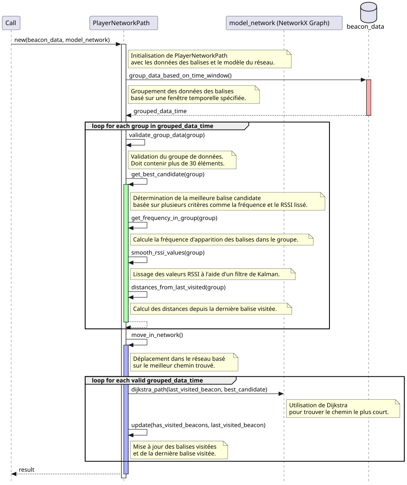
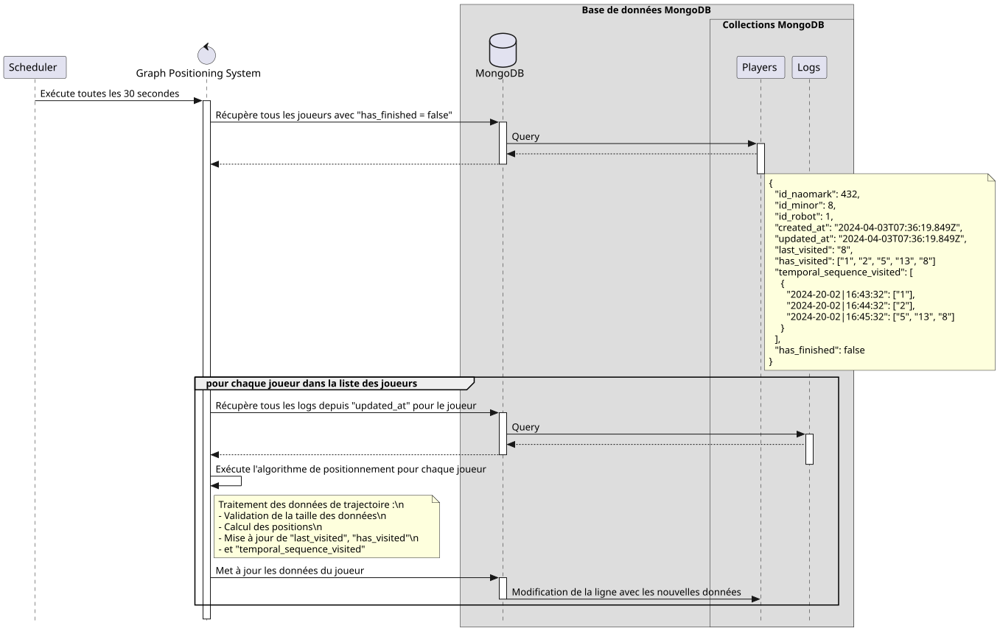
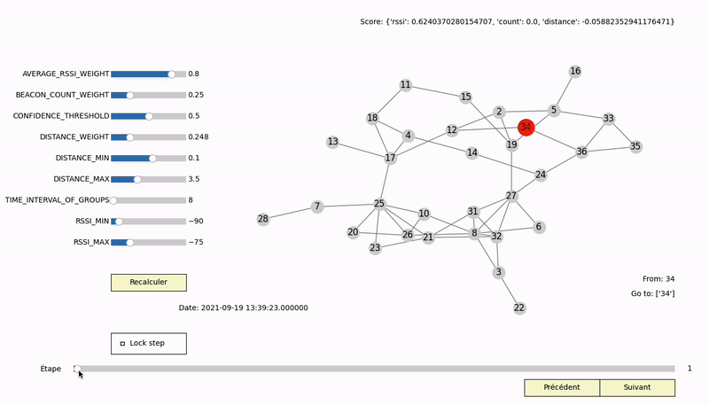

# Graph Positioning

Permet de localiser un joueur à partir de données de signaux BLE.

## Fichier de configuration

Possibilité de configurer tous les paramètres de l'algorithme depuis le fichier `config.json` permettant de changer l'URI de MongoDB ainsi que les paramètres de l'algorithme de Graph Positioning.

## Créer le graphe des possibles

Afin de créer le graphe des possibles de la manière la plus simple, on peut simplement écrire le graphe sous forme d'arêtes dans un fichier .txt avec les nœuds :
```
26,10
10,16
26,16
```

Et exécuter le script : `sudo python3 util/maker_gml.py fichier_texte.txt`, vous obtiendrez en sortie un fichier .gml fonctionnant avec NetworkX simplement.

## Visualiser des jeux de données

Dans le dossier `data/` quelque scenario sont initialisé permettant leur visualisation grâce à `test/visuel/mouvement_visuel_parametrage` en simplement changeant le dataset dans le fichier `config.json`.

## Traitement des données

- Les données sont traitées en utilisant l'algorithme de Graph Positioning pour identifier la position des joueurs.
- L'algorithme considère la force du signal (RSSI), la proximité avec les balises connues, et les informations historiques pour déterminer la position la plus probable.



--------

## Mise à jour de la position

- L'algorithme communique et mets à jour également les données du joueur dans le MongoDB.



--------

## Visualisation du parcours


